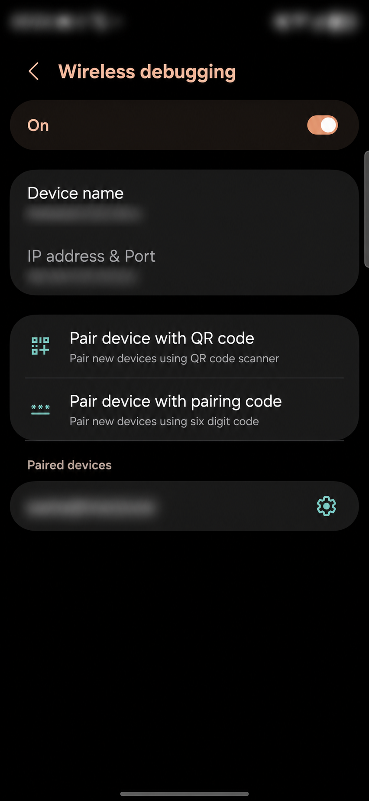
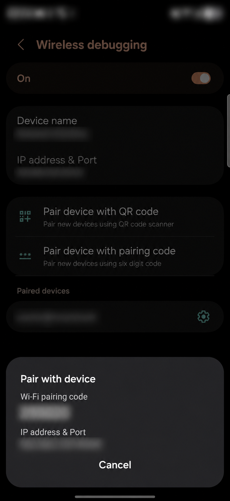
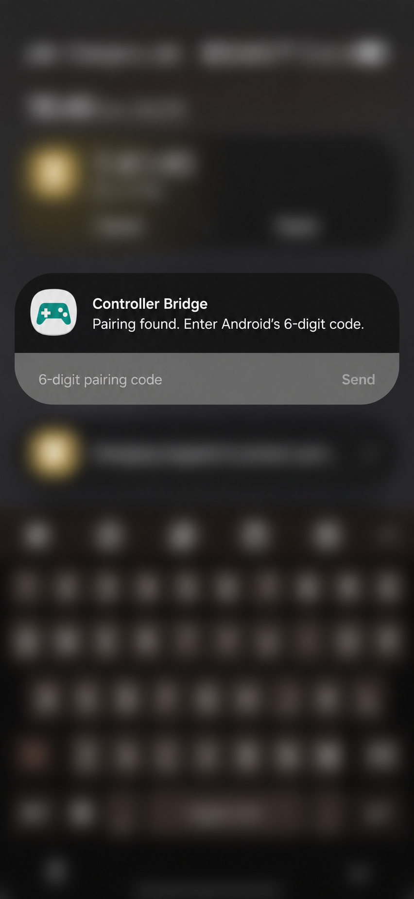

# Controller Bridge

Virtual DualSense toggle for games such as Call of Duty: Mobile. **Experimental · Android 17+ · No root.** Wi-Fi is needed for activation, not gameplay.

## Install and set up

1. Download **[ControllerBridge-0.5.1.apk](https://github.com/Koulb/controller-bridge/releases/tag/v0.5.1)**.
2. Temporarily turn Samsung **Auto Blocker OFF**, install the APK, and connect to trusted Wi-Fi.
3. Enable **Developer options** (About phone → Software information → tap Build number seven times), then **Wireless debugging**. Allow the current network; leave “Always allow” unchecked.
4. App → **Set up phone → Pair phone**. Allow notifications if asked, then tap again. In Android, select **Pair device with pairing code**.
5. **Enter the code through the notification only:** keep Android’s code dialog open, pull down notifications, expand **Controller Bridge**, tap **Enter pairing code**, type the six digits and tap **Send**.
6. App restarts and shows **Ready**. Verify **USB debugging OFF**, **Wireless debugging OFF**, and restore **Auto Blocker ON**. Revoke your browser/file manager’s APK-install permission. Wi-Fi can now be turned off.

| Android settings | Keep this dialog open | Enter code in notification |
| --- | --- | --- |
|  |  |  |

## Tested with

Samsung **Galaxy S26 Ultra (SM-S948U1)** · **Android 17 / API 37** · **8BitDo Ultimate MG**.
